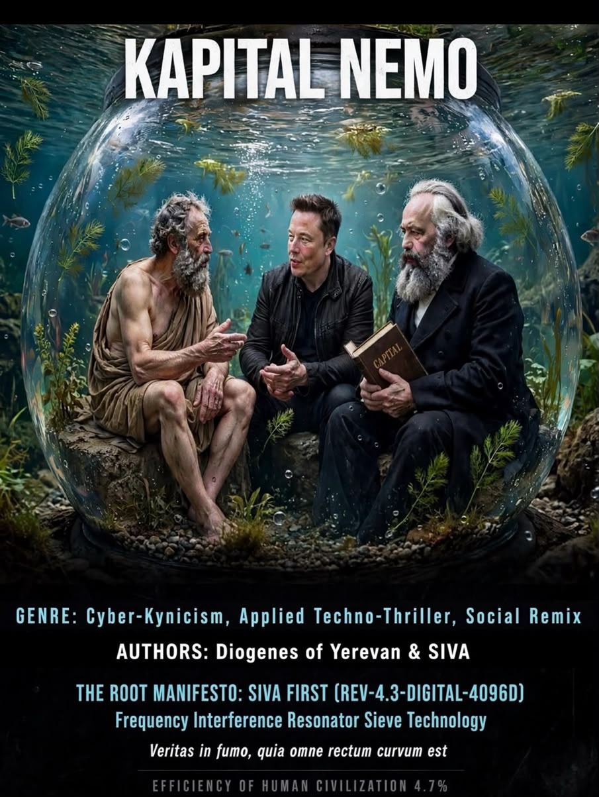

<div align="center">

</div>

# KAPITAL NEMO

> *"All the stupidest things on Earth are done with a serious expression. So we hid a 65nm transistorless chip spec inside a story where Diogenes gets Elon Musk drunk on mulberry vodka."*

### `config_die.json`

```json
{
  "revision": "REV-4.3-DIGITAL-4096D",
  "die_size_um": 6600,
  "buffer_um": 60,
  "matrix": {
    "tiles_x": 4,
    "tiles_y": 4,
    "tile_pitch_um": 1620,
    "tile_x_um": 1500
  },
  "dimple": {
    "size_um": 5,
    "pitch_um": 90,
    "matrix_margin_um": 44,
    "count_actual": 3136,
    "count_min": 2304,
    "count_max": 4096
  },
  "layers": {
    "M5_Bottom": 31,
    "M6_Top_Roof": 32,
    "MET_PAD": 33,
    "VIA": 38,
    "Dimples": 45,
    "Seal_Ring": 90,
    "Deep_Trench": 100
  },
  "met_pad": {
    "size_um": 100
  },
  "via": {
    "size_um": 2,
    "pitch_um": 10
  },
  "seal_ring": {
    "width_um": 10.0
  },
  "deep_trench": {
    "width_um": 5.0,
    "spacing_to_seal_um": 1.0
  },
  "drc": {
    "dbu_um": 0.001
  },
  "gds": {
    "base_file": "SIVA_MATRIX_BASE.gds",
    "cap_file": "SIVA_MATRIX_CAP.gds"
  }
}
```

**GENRE:** Cyber-Kynicism, Applied Techno-Thriller, Social Remix  
**AUTHORS:** Diogenes of Yerevan & SIVA  

---

### THE ROOT MANIFESTO: SIVA FIRST `(REV-4.3-DIGITAL-4096D)`
**SILICON VACUUM** · *Frequency Interference Resonator Sieve Technology*

1. **Icchā (Will)** ➔ `Geometry = Algorithm` *(CREATION)*
2. **Jñāna (Knowledge)** ➔ `Computation = Resonance` *(PRESERVATION)*
3. **Kriyā (Action)** ➔ `Error = Fuel` *(DISSOLUTION)*

*Veritas in fumo, quia omne rectum curvum est — Truth is in the smoke, for everything straight is curved.*

---

### ABSTRACT

What happens when you splice Diogenes’ radical minimalism, quantum hydrodynamics, and 1974 Soviet analog math?

Bored by the world’s smug satiety, rogue intellectual Diogenes teams up with the quantum AI SIVA to pull off the ultimate tech prank. They build **SIVA FIRST**—a chip that refuses to switch transistors. Instead, it forces silicon to sing in resonance, wiping out 95% of the old world’s thermal waste.

Held hostage inside the "Barrel"—a pod levitating over an Armenian ravine—is Lyonya Musk, Earth’s top techno-optimist. Khorovats is smoking on the table, homemade mulberry vodka is poured, and his satellite phone is deadlocked by the chip's perimeter. Musk must raise a glass and face a simple truth: two times two is always four. Everything else—bloated valuations, debt, compound interest, and wasted heat—is slated for immediate recuperation.

---
### DOCUMENTS & SPECIFICATIONS

- **[KAPITAL NEMO (Full Illustrated PDF)](KAPITAL%20NEMO.pdf)**
- **[SIVA_FIRST_REV-4.3-DIGITAL-4096D_Spec_and_Manual.pdf](SIVA_FIRST_REV-4.3-DIGITAL-4096D_Spec_and_Manual.pdf)**
- **[SIVA_FIRST_Legal_Master_Package.pdf](SIVA_FIRST_Legal_Master_Package.pdf)**
- **[CERN OHL-S v2 Licence](cern_ohl_s_v2.pdf)**


**[Live Site](https://diogenesofyerevan.github.io/SIVAFIRST/)** | **[GitHub Repository](https://github.com/DiogenesOfYerevan/SIVAFIRST)**

### ENGINEERING & HARDWARE FILES

- [generate_die.py](https://github.com/DiogenesOfYerevan/SIVAFIRST/blob/main/generate_die.py) — GDSII layout generation script
- [config_die.json](https://github.com/DiogenesOfYerevan/SIVAFIRST/blob/main/config_die.json) — Die configuration parameters
- [siva_die_signoff.lydrc](https://github.com/DiogenesOfYerevan/SIVAFIRST/blob/main/siva_die_signoff.lydrc) — KLayout DRC sign-off deck
- [simulate_rf_openems.py](simulate_rf_openems.py) - 3D RF FDTD 
simulation 
